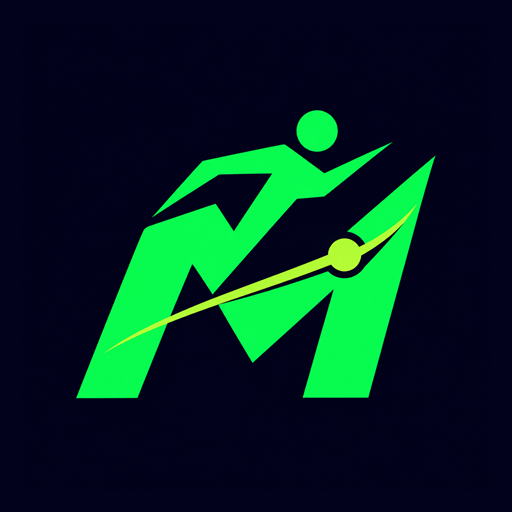
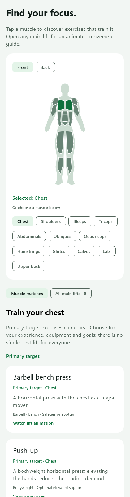
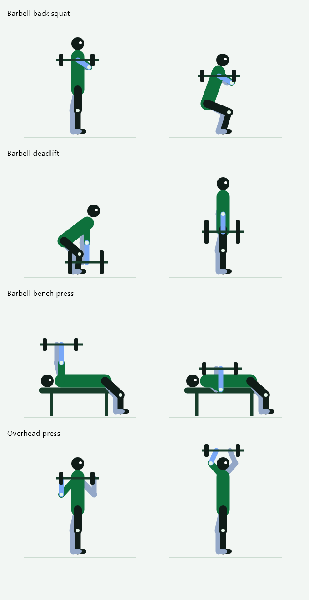
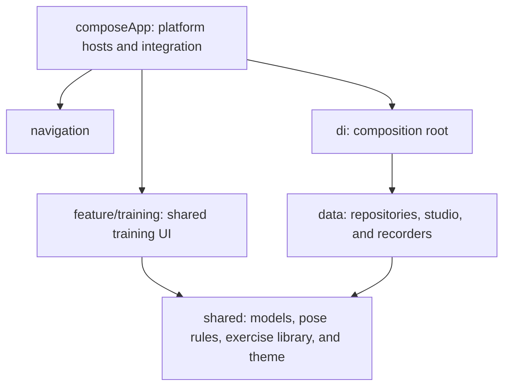

<div align="center">
  
  <h1>MzFit</h1>
  <p><strong>Plan your training. Log every set. See your progress.</strong></p>
  <p>A Kotlin Multiplatform fitness app combining workout tracking, visual exercise guides, and experimental on-device pose coaching.</p>
  <p>
    
    
    
    
  </p>
  <p><a href="#features">Features</a> · <a href="#ui-previews">UI previews</a> · <a href="#getting-started">Getting started</a> · <a href="#architecture">Architecture</a> · <a href="#testing">Testing</a></p>
</div>

## Overview

MzFit brings planning, performance logging, and movement education into one training workflow. Build a routine, record actual reps and loads, resume an unfinished session, and review progress from the workouts you complete.

**Android is the primary implementation.** It runs without an account or backend and stores training data locally in SQLite. Shared Compose screens also target desktop, web, and iOS, with different levels of feature support.

The current version is a development preview. It has been built and tested on Android; it is not a published App Store or Google Play release. Android 0.8.0 release preparation targets API 36 and includes upload signing and an in-app Privacy & safety screen. See the [Play release checklist](docs/PLAY_RELEASE.md) and [privacy policy](docs/PRIVACY.md) for the remaining publication gates.

## Features

### Plan and train

- **Custom routines:** select guided exercises or add your own, reorder movements, set repetition or timed targets, and assign optional training days.
- **Workout library:** nine starter plans with body-part filters and exercise search.
- **Live set logging:** record actual repetitions, external loads, timed sets, and workout notes in kilograms or pounds.
- **Previous-session guidance:** review earlier performance and explicitly reuse values in unchecked sets.
- **Rest timing:** automatic rest after logging a set, pause/resume, configurable duration, and persistent controls during training.
- **Recoverable sessions:** locally checkpointed drafts restore the latest saved workout state after the app closes.

### Understand movement

- **Interactive muscle map:** front/back views with 12 selectable muscle groups and primary/supporting exercise matches.
- **Exercise education:** 22 guides covering equipment, target muscles, and movement cues.
- **Animated lifts:** eight original 2D demonstrations with playback, half speed, reset, and scrubbing.
- **Experimental pose coaching:** CameraX and Google ML Kit provide live landmarks, rep counting, and tracked-angle feedback for bodyweight squats, standard push-ups, and biceps curls.

### Review your progress

- Local Monday–Sunday goals and a 28-day activity calendar.
- Heaviest recorded loads, per-exercise trends, and external-load volume calculated from actual logged repetitions.
- Completed-workout history with preserved exercise snapshots and editable journals.
- Separate pose-session history with rep measurements, feedback, and sampled observations.
- JSON export through Android's system file picker.

## UI previews

Shared Compose UI renders from the automated preview suite:

<table>
  <tr>
    <th>Muscle explorer</th>
    <th>Lift demonstrations</th>
  </tr>
  <tr>
    <td align="center"></td>
    <td align="center"></td>
  </tr>
</table>

## Platform status

| Platform | Current implementation | Verification |
| --- | --- | --- |
| **Android** | Persistent training studio, routines, progress, muscle map, animations, CameraX/ML Kit coaching, and export | Debug build, lint, device tests, installation, and launch verified; Android 8.0+ |
| **Desktop** | Shared workout/checklist, profile, muscle map, and animation screens; in-memory data | JVM compilation, shared tests, and offscreen UI tests verified |
| **Web** | Shared Compose/Wasm screens; in-memory data | Compilation verified; requires a WasmGC-capable browser |
| **iOS** | SwiftUI host, shared Compose screens, native camera/ML Kit implementation, and SQLite document storage | Source included; Xcode build, signing, and device validation remain pending |

Android's newer persistent training studio is not yet implemented on the other platforms. See the [iOS guide](iosApp/README.md) for Apple-platform setup and current limitations.

## Getting started

### Prerequisites

- JDK **21**.
- Android SDK Platform **35**, configured through Android Studio, `ANDROID_HOME`, or a local `local.properties` file.
- Network access for the first dependency download.
- An Android device with USB debugging enabled, or an emulator, to install the Android build.

The current implementation is on `codex/mzfit-training-studio`:

```sh
git clone --branch codex/mzfit-training-studio https://github.com/MajiinZ/MzFIT.git
cd MzFIT

# Build the Android debug APK
./gradlew :composeApp:assembleDebug

# Install on a connected device or running emulator
./gradlew :composeApp:installDebug
```

**Windows:** use `.\gradlew.bat` in place of `./gradlew`.

The APK is generated at `composeApp/build/outputs/apk/debug/composeApp-debug.apk`.

```sh
# Run the desktop application
./gradlew :composeApp:run

# Start the web development server
./gradlew :composeApp:wasmJsBrowserDevelopmentRun
```

For toolchain versions, SDK configuration, troubleshooting, and additional commands, see the [development guide](docs/DEVELOPMENT.md).

## Architecture

The project separates shared training behavior from native camera, storage, and application integration. Compose observes immutable state through `StateFlow`; platform adapters handle persistence and device capabilities.



| Module | Responsibility |
| --- | --- |
| `composeApp` | Platform entry points, Android studio screens, native camera integration, and storage adapters |
| `shared` | Training models, pose rules, exercise catalog, and theme tokens |
| `data` | Repository implementations, training-studio state, pose recording, insights, and storage contracts |
| `feature/training` | Shared workout, profile, progress, muscle-map, and animation UI |
| `di` | Explicit application composition and repository injection |
| `navigation` | Top-level destinations |

Android uses SQLite schema **4**, with explicit migrations and transactional workout completion. Actual measurements are stored separately from prescribed targets. A unique draft-to-workout marker prevents duplicate completion on retry. Read the [storage and recovery guide](docs/STORAGE.md) for details.

## Privacy and pose coaching

Training records remain on the device unless you choose to export them. Camera images and complete landmark sequences are not saved or uploaded. Saved pose logs contain sampled measurements, confidence, timing, and feedback. No account, cloud synchronization, advertising, or analytics integration is included.

Pose coaching uses **experimental 2D angle heuristics**, not a validated assessment of overall exercise technique or safety. It requires a clear side-on view and sufficient landmark confidence. Real-world accuracy has not been established through representative human-exercise testing. See [pose coaching and its limitations](docs/POSE_COACHING.md).

## Testing

The Android **0.7.0** validation completed on **November 17, 2026**, with **70 automated tests passing**: 47 shared/JVM tests and 23 Android instrumentation tests.

```sh
# Shared behavior and UI tests
./gradlew :shared:desktopTest :data:desktopTest :feature:training:desktopTest

# Android static analysis
./gradlew :composeApp:lintDebug

# Device/emulator instrumentation tests
./gradlew :composeApp:connectedDebugAndroidTest
```

Coverage includes draft recovery, save retries, atomic rollback, duplicate prevention, schema migrations, unit conversion, timed-set corrections, pose rules, calendar/DST boundaries, and load-volume calculations. This is a recorded local/device validation, not a live CI badge. See the [verification details](docs/DEVELOPMENT.md#automated-verification).

## Roadmap

- Validate complete training sessions, accessibility, and pose coaching with real users.
- Extend the training studio and persistent workflow to additional platforms.
- Add optional reminders, backup restoration, and richer training insights.
- Evaluate account sync, trainer/client workflows, and health-platform integrations.
- Complete signing, release automation, privacy review, and store distribution preparation.

These items are planned directions, not features available in the current preview. Product priorities are documented in the [competitive brief](docs/COMPETITIVE_BRIEF.md).

## Contributing

Use [GitHub Issues](https://github.com/MajiinZ/MzFIT/issues) for reproducible bugs and feature proposals. Include the app version, device/OS, reproduction steps, and expected versus actual behavior. Avoid attaching personal workout exports or identifiable camera footage.

For code changes, keep platform boundaries explicit, add focused regression tests for behavior changes, and document database migrations. See [repository conventions](docs/DEVELOPMENT.md#repository-conventions).

## Author and licensing

Developed by [Zak Falkenbach](https://github.com/MajiinZ). Project licensing has not yet been specified; third-party dependencies retain their respective licenses. Branding assets are documented [here](branding/README.md).
